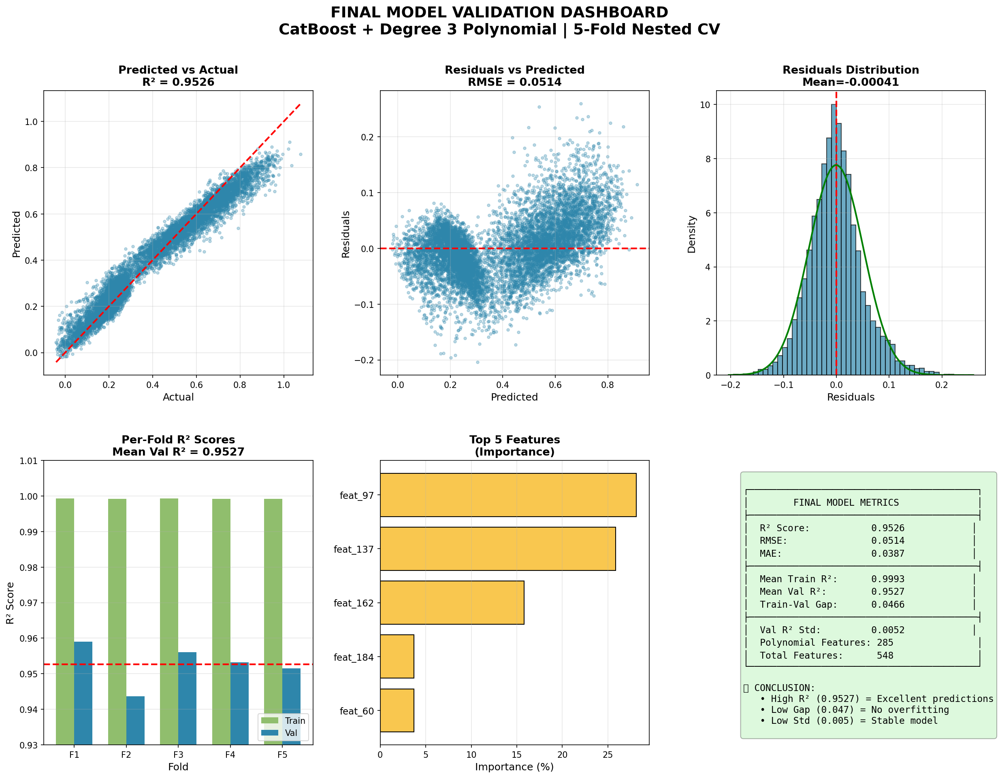

# Part 1: Predicting target01

## Approach
1. **Baselines:** Linear models (Ridge, Lasso, ElasticNet) reached only R² ≈ 0.05, so the relationship is non-linear. Tree ensembles were much stronger: Random Forest 0.09, XGBoost ≈ 0.70, LightGBM ≈ 0.72, CatBoost 0.77.
2. **Feature selection:** CatBoost feature importance. The top 10 features carry about 85% of the importance.
3. **Polynomial expansion:** Degree-3 terms on those 10 features (10 → 285 features). Degree 2 gave CV R² 0.928; degree 3 gave 0.953 with a smaller train–validation gap (0.047 vs 0.070).
4. **Model:** CatBoostRegressor, 800 trees, learning rate 0.05, depth 10. Hyperparameter tests showed depth 12 overfits.
5. **Ensembles:** Averaging or stacking CatBoost with XGBoost and LightGBM scored lower (≈ 0.86–0.91), so CatBoost was used alone.

## Validation
5-fold cross-validation. Feature selection and polynomial fitting are repeated inside each fold, so the validation folds never influence them.

| Fold | Validation R² | Validation RMSE |
|------|---------------|-----------------|
| 1 | 0.959 | 0.048 |
| 2 | 0.944 | 0.057 |
| 3 | 0.956 | 0.049 |
| 4 | 0.953 | 0.051 |
| 5 | 0.952 | 0.052 |
| **Mean** | **0.953** | **0.051** |

