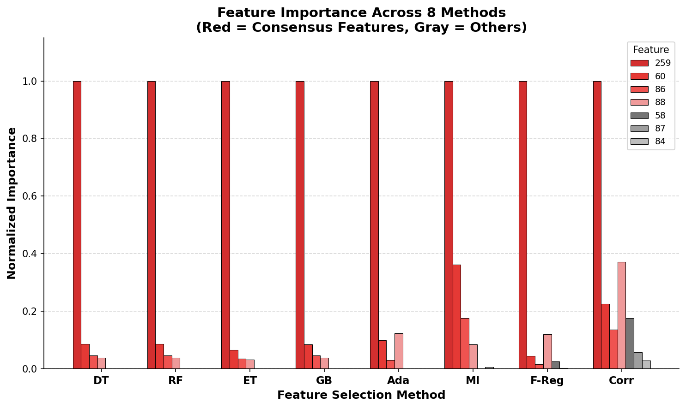
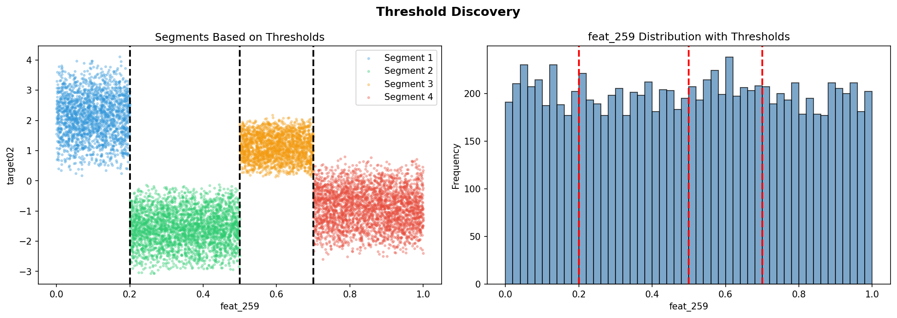

# Part 2: Rule discovery for target02

The goal was to reconstruct the rules that generate `target02`, not to fit an approximate model.

## Feature identification
Eight methods (decision tree, random forest, extra trees, gradient boosting, AdaBoost, mutual information, F-regression, correlation) were compared. Four features ranked in the top 5 for every method: `feat_259`, `feat_60`, `feat_86`, `feat_88`.

## Switcher variable
`feat_259` was the root split of the decision tree. It selects which linear formula applies rather than contributing to the formula itself.

## Thresholds
Split points from the tree, refined by a grid search: 0.2, 0.5, 0.7.

## Rules
| Condition | Formula |
|-----------|---------|
| `feat_259 ≤ 0.2` | 1.25·f60 + 1.15·f86 + 1.85·f88 |
| `0.2 < feat_259 ≤ 0.5` | −1.45·f60 − 1.45·f86 − 0.25·f88 |
| `0.5 < feat_259 ≤ 0.7` | 1.25·f60 + 0.65·f86 + 0.35·f88 |
| `feat_259 > 0.7` | −1.75·f60 − 0.95·f86 + 0.95·f88 |

Each segment was fitted with linear regression and the intercept came out at zero. The coefficients are multiples of 0.05.

## Validation
- 5-, 10-, and 20-fold CV: R² = 1.0
- Shuffling `feat_259` drops R² to −0.89; shuffling `feat_60`, `feat_86`, or `feat_88` drops it to 0.85–0.93
- Moving any threshold by 0.01 lowers R²
- Maximum absolute residual ≈ 1e-14

## Limitations
The rules are specific to this dataset. They hold only if the evaluation data has the same distribution as the training data.
